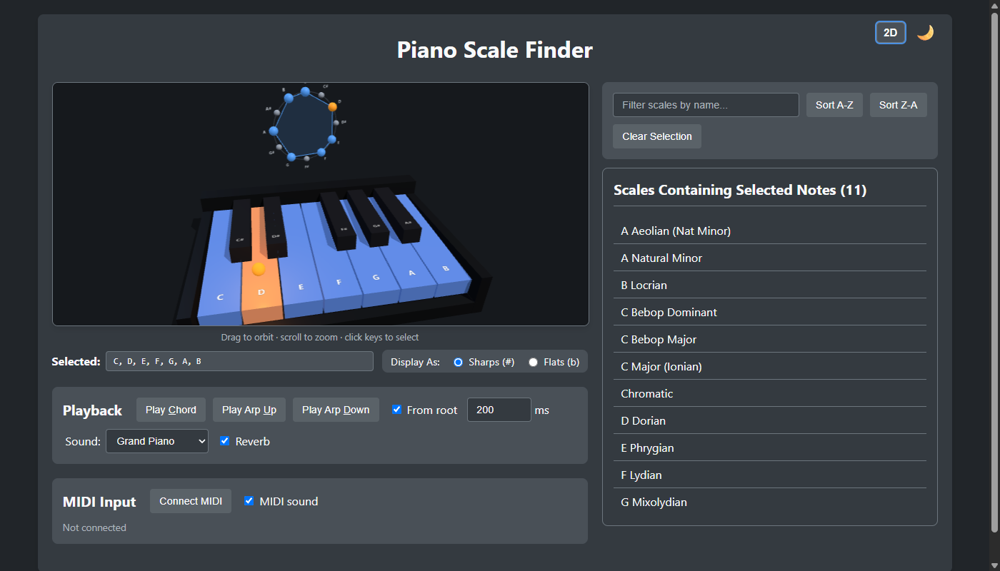
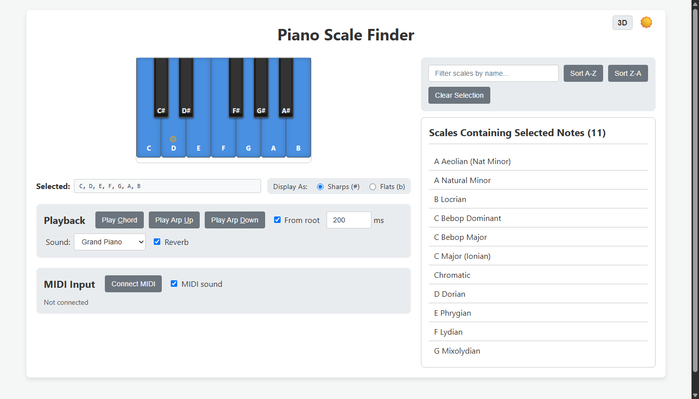
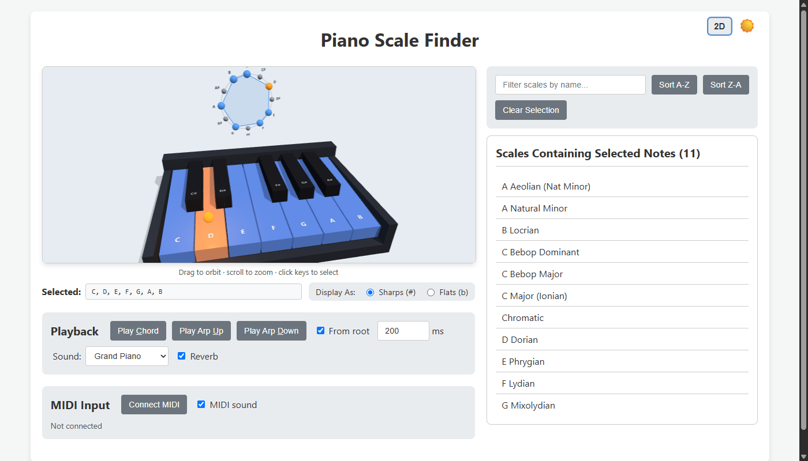

# Piano Scale Finder

A simple, interactive single-page web application designed to help users explore musical scales on a piano keyboard — in 2D or 3D, with mouse, computer keyboard or a MIDI keyboard.

| 2D, light theme | 3D, light theme |
|---|---|
|  |  |

## Features

*   **Interactive Piano Keyboard:** Displays a standard C-to-B piano octave (including sharps/flats).
*   **Note Selection:** Click on piano keys to toggle their selection.
*   **Scale Identification:** Automatically displays a list of all musical scales that contain the currently selected notes.
*   **805 Scales:** 67 scale types in all 12 keys (plus Chromatic): the major modes, harmonic minor, melodic minor and harmonic major with all their modes, pentatonics, hexatonics, blues, bebop, symmetric (whole tone, diminished, augmented) and many world scales. Each type is defined once by its interval formula and generated in every key.
    *   Shows all scales if no notes are selected.
*   **Scale Filtering:** Filter the list of scales by name using the search input.
*   **Scale Sorting:** Sort the displayed scale list alphabetically (A-Z or Z-A).
*   **Scale Selection:** Click on a scale name in the list to instantly select only the notes belonging to that scale on the keyboard.
*   **Selected Notes Display:** Shows the currently selected notes (sorted chromatically) in a text field for easy reference or copying.
*   **Enharmonic Toggle:** Switch the display of accidentals (black keys, selected notes and scale names) between sharps (#) and flats (b). The scale filter matches either spelling, e.g. `Bb` or `A#`.
*   **Audio Playback (Web Audio API):**
    *   Play the selected notes simultaneously as a **Chord**.
    *   Play the selected notes sequentially as an **Arpeggio** (ascending or descending).
    *   Adjust the playback speed for arpeggios.
    *   **From root:** arpeggios start on the root note and finish on the root an octave up (e.g. D Dorian plays D E F G A B C D).
*   **Keyboard Shortcuts:** `C` Play Chord, `U` Play Arp Up, `D` Play Arp Down (underlined in the button labels; ignored while typing in a text field).
*   **Light/Dark Mode:** Toggle between light and dark themes for visual preference. The setting is saved in your browser's `localStorage`.
*   **Remembers Everything:** Theme, 2D/3D view, selected keys and root, sharps/flats, arpeggio speed and From root, instrument, reverb, MIDI on/off and MIDI sound are saved in `localStorage` and restored on reload.
*   **Root Note Highlight:** When a scale is selected from the list, its root note is visually indicated on the keyboard. With manual selection, the first note you select becomes the root.
*   **MIDI Input (Web MIDI API, Chrome/Edge):** Click **Connect MIDI** to play a MIDI keyboard into the app (click again to disconnect).
    *   Each key press toggles that note, exactly like clicking it.
    *   Optional sound at real pitch with velocity and sustain-pedal support; devices can be hot-plugged.
*   **Key Feedback Sound:** Clicking a key (2D or 3D) plays that note.
*   **Instruments:** Choose Grand Piano, Electric Piano, Organ, Pluck / Harp, Warm Pad or Classic Triangle, with optional reverb. A master limiter prevents clipping on big chords. Choices are remembered.
*   **3D Mode (three.js):** Click the `3D` button (top-right) to swap the flat keyboard for a 3D one:
    *   Selected keys sink and glow, the root note glows orange with a floating marker orb.
    *   Keys bounce in time with chord/arpeggio playback.
    *   A floating 12-note "pitch-class ring" draws the selected notes as a polygon — each scale's shape.
    *   Drag to orbit, scroll to zoom, click keys to select. The view choice is remembered.
    *   three.js r187 (ES modules from jsDelivr) is loaded from a CDN only when 3D mode is first enabled (needs internet; falls back to 2D otherwise).

## How to Use

1.  **Download:** Ensure you have the following files in the same directory:
    *   `index.html`
    *   `style.css`
    *   `script.js`
    *   `synth.js`
    *   `piano3d.js`
2.  **Open:** Open the `index.html` file in a modern web browser (e.g., Chrome, Firefox, Safari, Edge) that supports the Web Audio API for playback features.
3.  **Interact:**
    *   Click piano keys to select/deselect notes.
    *   Observe the "Available Scales" list update automatically.
    *   Use the filter field or sort buttons to manage the scale list.
    *   Click a scale name in the list to select its notes.
    *   Use the enharmonic toggle (#/b) to change accidental display.
    *   Use the playback buttons (or `C` / `U` / `D`) to hear the selected notes, and pick an instrument from **Sound**.
    *   Click **3D** to switch to the 3D keyboard, or **Connect MIDI** to use a MIDI keyboard.
    *   Use the theme toggle button (☀️/🌙) in the top-right corner to switch between light and dark modes.

## Live Demo

**[fancellu.github.io/piano-scales-js](https://fancellu.github.io/piano-scales-js/)** (hosted on GitHub Pages)

## File Structure

*   **`index.html`**: Contains the HTML structure of the application, including the layout for the keyboard, controls, and lists. Links to the CSS and JavaScript files.
*   **`style.css`**: Contains all the CSS rules for styling the application, including keyboard appearance, layout, colors (with light/dark mode variables), and responsiveness.
*   **`script.js`**: Contains all the JavaScript logic, including:
    *   Keyboard generation and event handling.
    *   Scale formulas, generated in all 12 keys.
    *   Scale filtering and display logic.
    *   Playback, keyboard shortcuts and MIDI input.
    *   Enharmonic preference handling.
    *   Theme switching and `localStorage` persistence.
*   **`synth.js`**: Web Audio synth engine — instrument presets, limiter and reverb (exposes `window.Synth`).
*   **`piano3d.js`**: The optional three.js 3D keyboard view (lazy-loads three.js, exposes `window.Piano3D`).
*   **`screenshots/`**: Images used in this README.

## Technologies Used

*   HTML5
*   CSS3 (including CSS Variables for theming)
*   JavaScript (ES6+)
*   Web Audio API
*   Web MIDI API
*   [three.js](https://threejs.org/) r187 (3D mode, ES modules loaded on demand from jsDelivr)

## Potential Future Enhancements

*   **Interval Display:** Show each scale's interval pattern (W-W-H...) and degrees (1 2 b3...), derived from its formula.
*   **Multi-Octave Display/Playback:** Extend the keyboard and playback to cover more than one octave.
*   **Key-Signature Spelling:** Spell notes per key signature (e.g. E# in F# major) rather than by the global sharps/flats toggle.
*   **Chord Identification:** Add logic to identify common chord names based on selected notes.
*   **Sampled Instruments:** Add real piano samples alongside the synthesized instruments.
*   **Shareable Links:** Encode the selection in the URL.
*   **Ear Training:** Play a random scale and guess its name.
*   **Mobile Responsiveness:** Further improve layout adjustments for smaller screens.

---

Enjoy exploring scales!